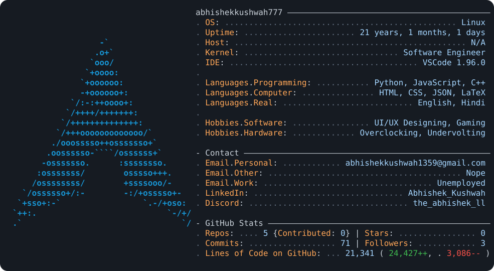

  <picture>
    <source
      media="(prefers-color-scheme: dark)"
      src="./dark_mode.svg"
    />
    <source
      media="(prefers-color-scheme: light)"
      src="./light_mode.svg"
    />
    
  </picture>

